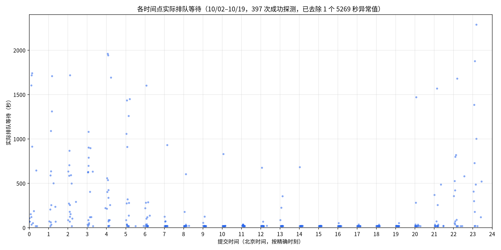
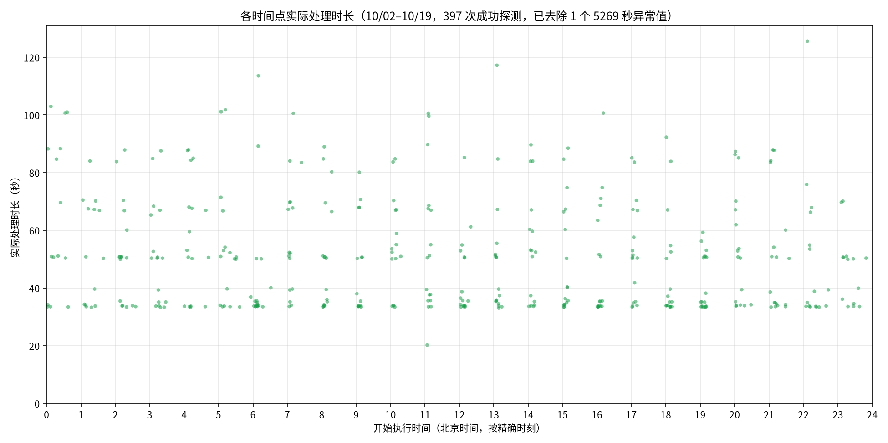
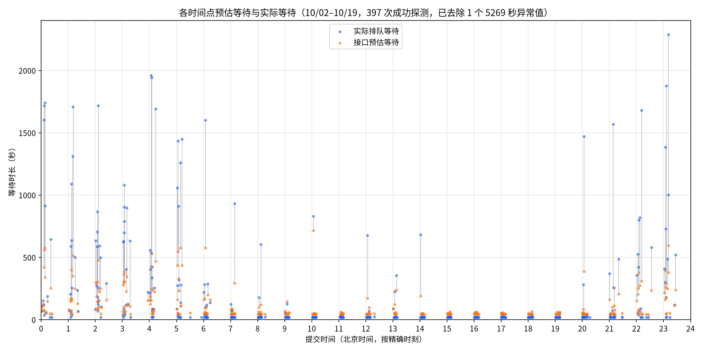
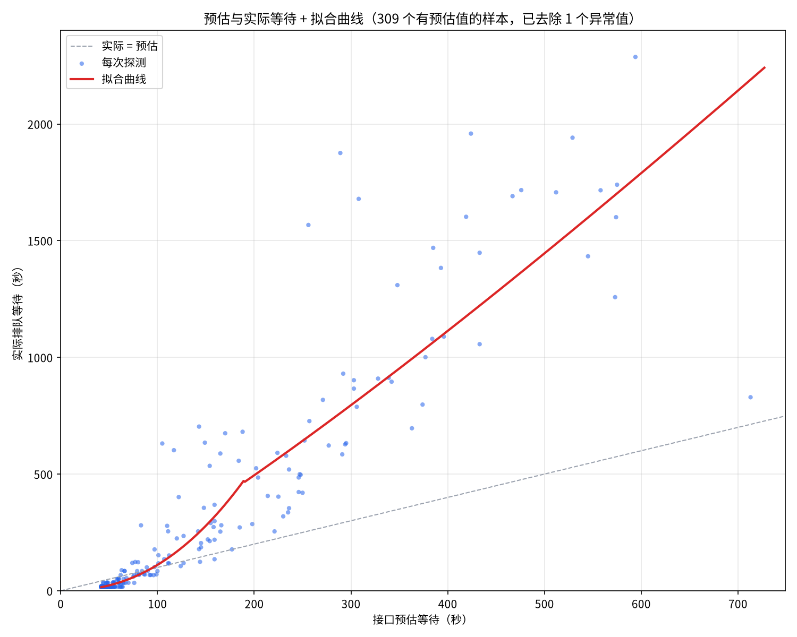

# MVSEP 免费额度监测记录

## 结论

MagicDub 完全可以使用免费的 MVSEP 额度来降低成本。

免费档在不同时段的等待时长差别很大：北京时间 7:00–21:00 基本不用排队，排队中位数约 17–19 秒；23:00 到次日 5:00 最慢，每小时的中位数在 2 到 7 分钟之间。现在已经回归出一个函数，可以根据接口返回的预估等待时长，大致算出实际要等多久。实际使用时，可以先按这个函数估算等待时间，再决定用免费额度还是改用收费版。

## 一、监测目的

验证能否长期使用 MVSEP 的免费额度，让 MagicDub 项目在真实使用时尽量少花 MVSEP 的钱。具体要回答三个问题：免费档在一天里各个时段要排多久；处理时长是否稳定；接口返回的预估等待时长能不能用来判断实际要等多久。

## 二、监测方法

从 2026-10-02 到 2026-10-19，每个整点用 MVSEP 免费档提交一段 90 秒的探针音频。分离参数和 magicdub-cli 实际使用的完全一样：DnR v3，Mel + SCNet，直接从混音中提取，输出 m4a。每次提交前都用 ffmpeg 往探针文件的元数据里写一个唯一标记，并换一个上传文件名，免得服务端直接复用缓存结果。提交时记下接口返回的预估等待时长，之后每 15 秒查一次任务状态，记录实际排队等待（从提交到开始处理）和实际处理时长（从开始处理到完成），全部写进本地 SQLite 数据库。

这段时间共有 397 次成功探测可以用来分析，其中 309 次接口给出了预估值。另有 12 次因为报错或超时没有完成，不计入统计。10/06 11:02 有一次排队 5269 秒（约 88 分钟），远远超出其他所有样本，作为极端值剔除，以下结果都不含这一次。

需要注意的是，状态每 15 秒才查一次，再加上请求本身的耗时，所以实际时长只能精确到大约 17 秒。100 秒以内的短等待受这个影响最明显。

## 三、结果

### 1. 各时间点的实际排队等待

各小时的排队中位数（北京时间）：

| 时段 | 排队中位数 |
|---|---|
| 7:00–21:00 | 17–19 秒 |
| 22:00 | 约 80 秒 |
| 23:00 | 约 446 秒（约 7.4 分钟） |
| 0:00–5:00 | 110–312 秒 |
| 6:00 | 约 35 秒 |

7:00–21:00 基本是闲时，其中 15:00–19:00 最稳定。23:00 到次日 5:00 是慢时段，偶尔会排到 25–38 分钟。22:00 和 6:00 是过渡时段。

### 2. 各时间点的实际处理时长

处理时长和时段没有关系：中位数约 50.3 秒，平均约 51.1 秒，范围 20–126 秒，没有极端值。结果大致分成约 34、50、67、85 秒几层，一方面是因为每 15 秒才查一次状态，另一方面可能是任务被分到了速度不同的服务器上。所以总耗时快慢主要取决于排队。

### 3. 各时间点的预估等待与实际等待

蓝点是实际排队时间，橙点是接口的预估，灰线把同一次探测的这两个值连起来。接口的预估在两头都不准：

| 预估区间 | 样本数 | 实际 ÷ 预估（中位数） | 说明 |
|---|---|---|---|
| 60 秒以下 | 169 | 0.39 | 全部高估，实际只要 17–20 秒 |
| 60–100 秒 | 42 | 0.82 | 最准，35 次落在预估的 0.5–2 倍之间 |
| 100–200 秒 | 42 | 1.61 | 37 次低估，波动最大 |
| 200–400 秒 | 41 | 2.56 | 全部低估 |
| 400 秒以上 | 15 | 3.33 | 全部低估，样本较少 |

预估超过 100 秒基本都会低估，而且预估越大，偏差越大。

### 4. 回归出的函数

用 309 个有预估值的样本，在对数尺度上做分段幂函数回归，分界点是预估 190 秒：

- 预估 e ≤ 190 秒：实际 ≈ 0.0032 × e^2.27
- 预估 e > 190 秒：实际 ≈ 466 × (e / 190)^1.17

按这个公式估算，约 73% 的样本误差在 ±30% 以内，约 92% 落在估算值的 0.5–2 倍之间。预估在 100 秒以内时，公式和实际的中位数几乎重合。

### 5. 预估与实际等待加拟合曲线

预估在 200 秒以内时，曲线基本从点群中间穿过。200–600 秒之间，点分布在曲线两侧，上下相差几百秒。预估 713 秒的那个样本远低于曲线，这一段样本太少，曲线是按趋势外推的。190 秒处的拐点是两段公式的接缝。

## 四、函数公式

设接口返回的预估等待时长为 \(e\)（秒），实际排队等待的估算值（秒）为：

$$
\text{实际等待} \approx
\begin{cases}
0.0032 \cdot e^{2.27}, & e \le 190 \\
466 \cdot \left(\dfrac{e}{190}\right)^{1.17}, & e > 190
\end{cases}
$$

几个参考值：

| 预估 | 估算的实际等待 |
|---|---|
| 50 秒 | 约 23 秒 |
| 100 秒 | 约 111 秒 |
| 150 秒 | 约 279 秒 |
| 300 秒 | 约 795 秒（约 13 分钟） |
| 500 秒 | 约 1450 秒（约 24 分钟） |

使用建议：免费档尽量放在 7:00–21:00 用，最好是 15:00–19:00。提交前先按上面的公式估一下实际要等多久，如果超过任务能接受的等待时间，就改用收费版。预估在 100–200 秒之间时波动最大，需要留余量的话按预估的 4 倍准备。

*数据来源：本机 MVSEP 整点监测数据库，样本截至 2026-10-19 21:08（北京时间）。*
